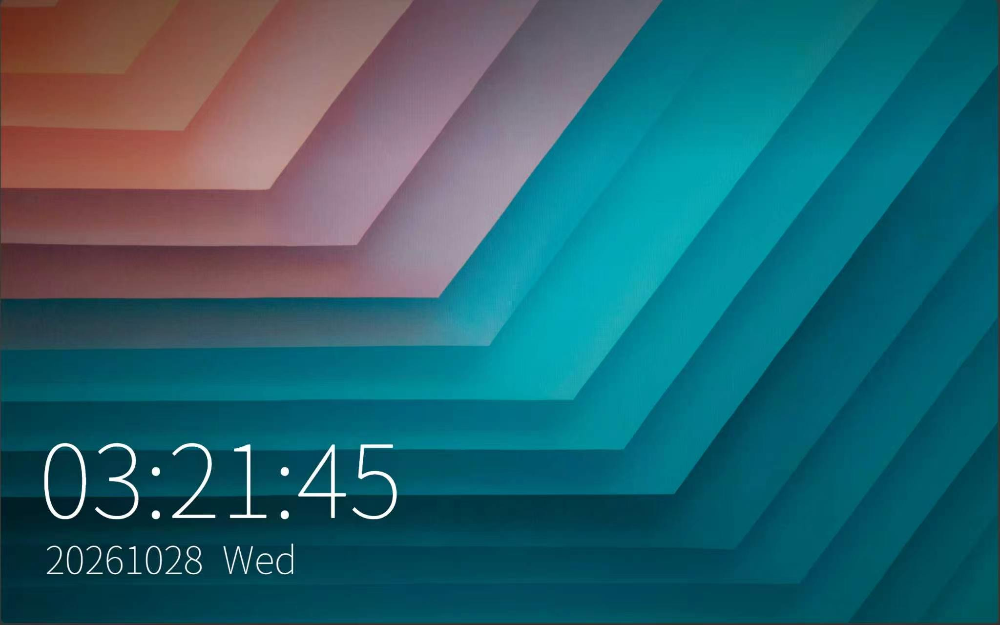
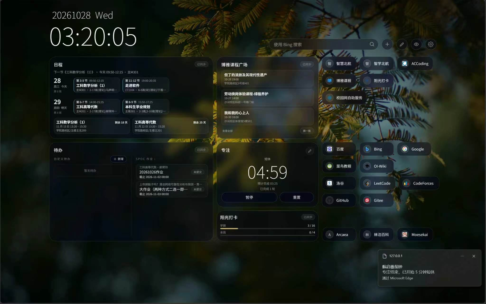
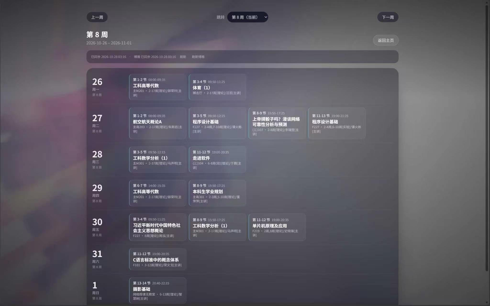
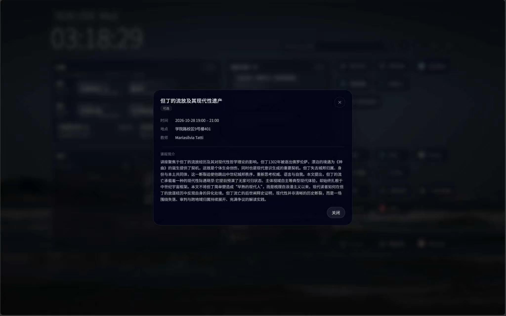
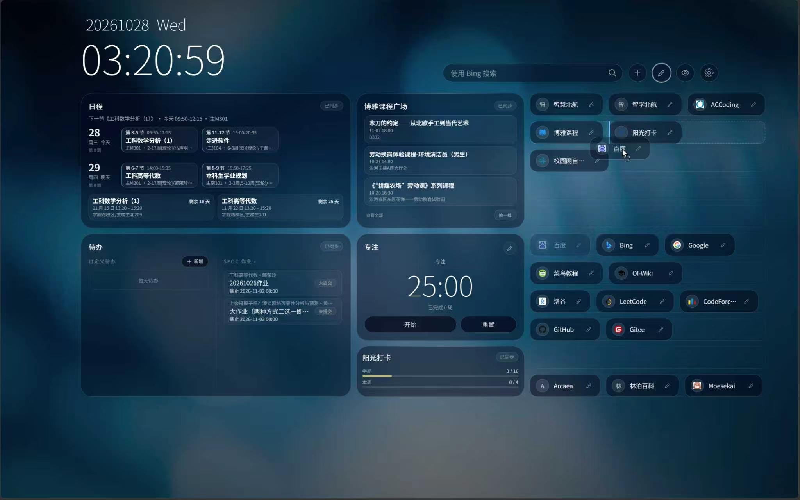
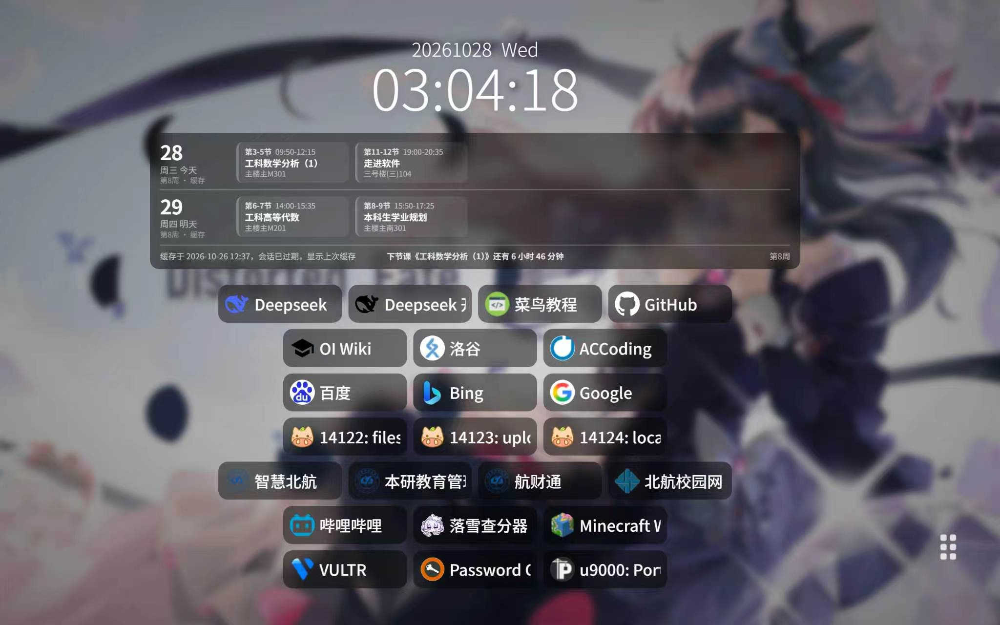

# 航启首页 · abuu-start · 更适合北航宝宝体质的浏览器启动页

[](https://ai-declaration.md)

> ⚠️ **免责声明：本软件为学生开发者制作的第三方工具，与北京航空航天大学官方无任何隶属、授权、利益关系。涉及校方通知、制度、课程安排、成绩结果、预约规则、系统可用性或其他正式信息时，请始终以北京航空航天大学官方发布内容为准。用户应自行评估使用本项目带来的风险，并妥善保管个人账号、密码、验证码和会话信息。**

> ⚠️ **AI 使用说明：本作品由 AI 辅助生成，具体使用范围与级别见 [AI-DECLARATION.md](AI-DECLARATION.md)**

> 🙏 **致谢**
> 本项目所使用的北京航空航天大学系统 API 接入部分基于 [BUAASubnet/UBAA](https://github.com/BUAASubnet/UBAA) 开发，感谢原作者及维护者的开源工作。

航启首页是一款面向北京航空航天大学本科生的浏览器首页，基于 Vite、Vue.js、Tailwind CSS 构建，提供课表、考试、博雅课程、SPOC 作业、阳光打卡的便携**查询**功能；此外，还提供番茄钟专注、自定义待办和常规的浏览器主页快捷入口功能。

该项目尚处早期阶段，部分功能尚不成熟或有待完善。

项目主页：[点这里](https://osmrpighead.github.io/abuu-start)

## 核心功能

- 随机壁纸：支持自选壁纸目录，打开浏览器就能看到自推各式美图多是一件美事啊哈哈哈哈哈）
- 高自由度的书签：提供 11 行书签，放不下还能左右滚动，主打一个我埃及吧放哪就放哪
- 日程：聚合常规课表、博雅已选课程、考试提醒（我觉得博雅就应该显示在常规课表里
- 待办：提供自定义待办和 SPOC 作业查询功能，~~用了还被 DDL 追当我没说~~
- 博雅课程广场：随机推荐三个博雅课，妈妈再也不用担心我错过有意思的博雅课啦！
- 专注：可以自定义时间的番茄钟，有谁不想看着自推美图写作业呢？
- 阳光打卡：学期和当周打卡次数统计，告别电脑前久坐，远离痔疮（x



## 运行

### 运行预编译产物

**目前仅提供 Windows x64 版本，macOS 或 Linux 系统用户请通过下方“自行构建”运行**，欢迎有能力对 macOS 或 Linux 场景进行调试和开发的贡献者参与本项目的贡献。

1. **安装扩展**：从 [Releases](https://github.com/osMrPigHead/abuu-start/releases) 下载扩展后（后缀名为 `crx` 或 `zip`，Edge、360 浏览器、QQ 浏览器等均使用 `chrome-mv2`），解压到任意目录，在浏览器扩展管理中启用开发人员模式，选择“加载已解压的扩展”
2. **启用中继**：从 [Releases](https://github.com/osMrPigHead/abuu-start/releases) 下载 `.exe` 可执行文件后，双击运行即可，通过系统托盘监测运行状态（目前构建版本为自签名证书签署，会导致 SmartScreen 警告，是正常现象）。

### 自行构建

本地运行方式：

```bash
npm install
npm start                 # 本地中继 + 托盘，127.0.0.1:26171
npm run dev               # WXT 开发服务器（Chrome/Edge），localhost:4000
npm run dev:firefox       # WXT 开发服务器（Firefox）
npm run build             # Chrome/Edge MV3 -> .output/chrome-mv3
npm run build:firefox     # Firefox MV2 -> .output/firefox-mv2
npm run build:server      # Windows x64 单文件中继 -> dist/server/abuu-start-relay.exe
npm run build:server:gui  # Windows x64 单文件中继（窗口版本） -> dist/server/abuu-start-relay.exe
npm test                  # Vitest
```

- 中继与 WXT 开发服务器是两个独立进程：先 `npm start`，再按目标浏览器启动开发服务器。
- `npm run build:server` 仅支持 Windows x64，需 Node >=22.12；默认执行一次 `TRAY=0` 启动冒烟测试，`npm run build:server -- --no-smoke` 可跳过；可用 `--no-sign` 和 `--no-timestamp` 跳过签名和时间戳，用 `--gui` `--windowed` `--no-console` 可构建窗口版本。
- 中继 exe 不依赖目标机的 Node 或 `node_modules`；首次启用托盘时把 `tray-hook` 组件释放到 `%LOCALAPPDATA%\abuu-start\runtime\`，释放失败时降级为无托盘，API 仍可用。
- `TRAY=0` 可关闭托盘；`PORT` 可改中继端口；`WXT_RELAY_ORIGIN` 可改扩展访问的中继地址。

## 技术方案

前端使用 WXT 构建 Chrome/Edge MV3 与 Firefox MV2 扩展，Vue 3 SPA 接管新标签页；后端是 Node.js + Express 本地中继，只提供 `/api`，负责统一认证、教务数据聚合、背景图片与本机设置。开发时 `npm start` 直接运行 TypeScript 中继，`npm run dev` 启动 WXT；发布时中继可构建为 Windows x64 单文件 exe，目标机无需安装 Node。其他个性化设置（打卡目标、日程高亮时间阈值、主页卡片显示状态、番茄钟桌面通知）与课表、作业缓存均存储在浏览器 localStorage。

## LICENSE

- 本项目采用 MIT License 开源，部分基于 [BUAASubnet/UBAA](https://github.com/BUAASubnet/UBAA) (MIT License) 开发
- [项目主页](slides/) 使用 [reveal.js](https://reveal.js/) (MIT License) 构建，使用了 [TonyCrane/slides-template](https://github.com/TonyCrane/slide-template) 作为模板。该模板仓库未包含 LICENSE 文件。模板相关权利归原作者所有，本作品仅用于个人课程项目展示，不将模板部分纳入本仓库根目录 MIT License 的授权范围。如原作者认为使用不当，请联系我删除或调整。

## 碎碎念：为什么会有这个项目

这个项目是作者在走软课 ddl 还有三天的时候赶工赶出来的东西，想着做个这玩意儿做出来了我自己还可以用用；然后发现效果意外的好~~（AI 还是太好用了.jpg）~~于是放到 GitHub 上了

既然有 UBAA 为什么还会做这个呢？不难发现的是 UBAA 是个主要服务于移动端平台的软件，Windows 版只是用 Compose Multiplatform 顺带做的移植版，UI 什么的都是基于手机去设计的。但是我自己又是一个重度电脑使用者（能用电脑决不用手机这一块），就导致有的时候我坐在上一节课的教室里，说，下节课去哪个教室来着，还得掏出手机看一眼才能知道；这是个很不优雅的事情，我应该在电脑上按两个快捷键就能解决这种事。

那这就不得不说到作者原本的浏览器主页了，是在前 AI 时代自己做的（不过课表功能是后来加上的），当时原本是想解决随机背景图片这个问题：



但这个主页所有的书签都得自己用 JSON 配置，课表也是让直接输入 Cookie 的纯前端方案，虽然我自己用着觉得不错，但当个作业交上去多少有些寒颤了，于是乎就诞生了分析下 UBAA 源码，做一个功能更全面的浏览器主页的想法。

其实用了 AI 问题也挺多的（）即使有了 UBAA 这么个前人智慧的结晶，还是会有些界面需要提供 HAR 才能解析出来，而且也还会有很少的 bug 得靠古法调试才能合心意地解决。但不管怎么着两天确实把这项目给做出来了，可喜可贺（误

**再次感谢 [BUAASubnet/UBAA](https://github.com/BUAASubnet/UBAA) 的开源，真的帮我省了不少 token 和头发**

~~**还要感谢大肥鱼**~~