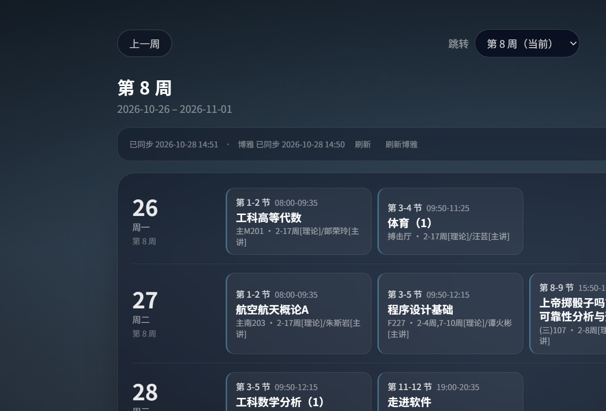
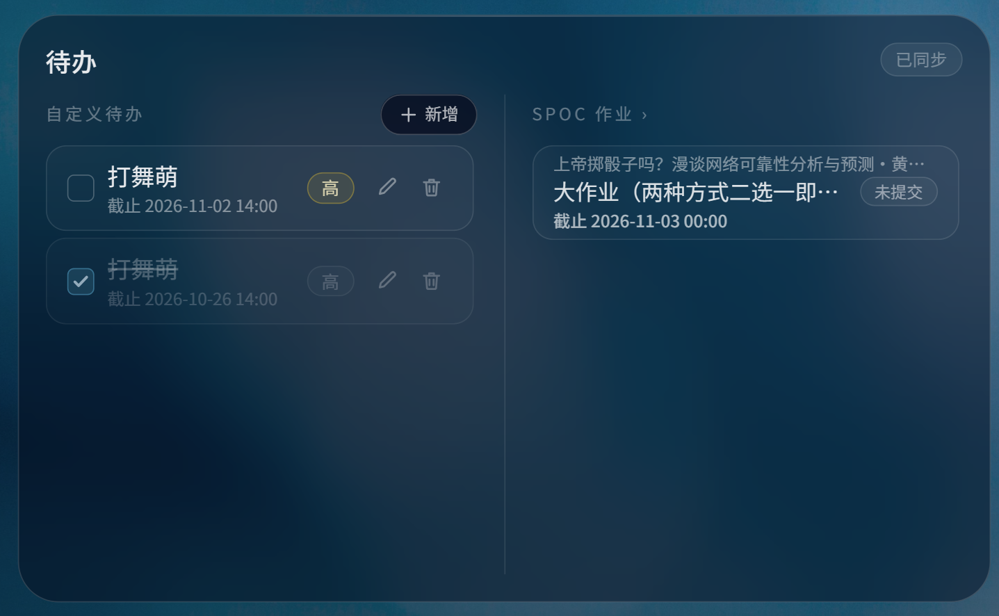
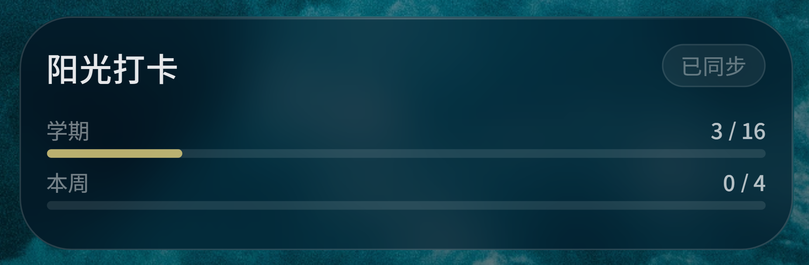
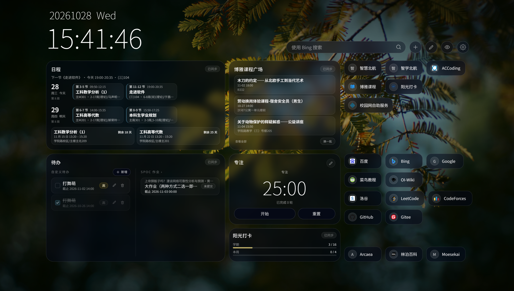
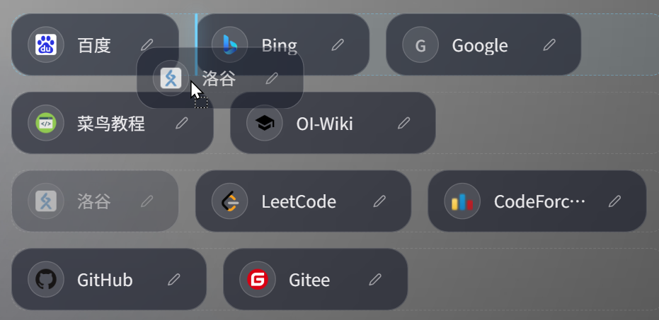
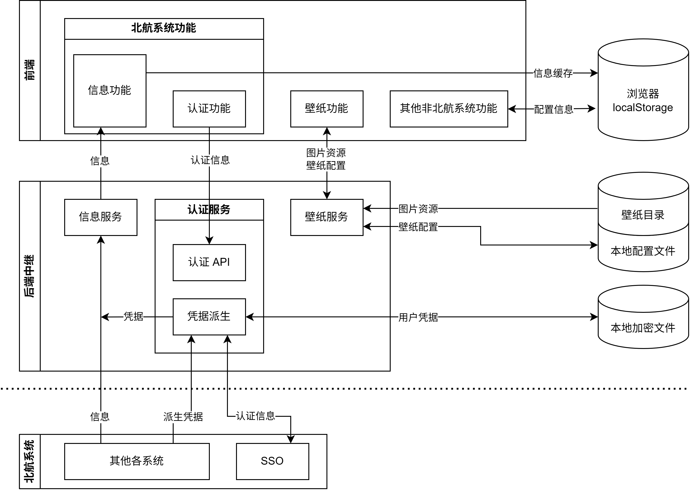

<div class="middle center">
<div style="width: 100%">

# 航启首页

更适合北航宝宝体质的浏览器启动页

<hr/>

By osMrPigHead

<a href="https://github.com/osMrPigHead/abuu-start" style="vertical-align: bottom; font-size: 24px;"><svg data-component="Octicon" aria-hidden="true" focusable="false" class="octicon octicon-mark-github" viewBox="0 0 24 24" width="32" height="32" fill="currentColor" display="inline-block" overflow="visible" style="vertical-align:text-bottom"><path d="M10.226 17.284c-2.965-.36-5.054-2.493-5.054-5.256 0-1.123.404-2.336 1.078-3.144-.292-.741-.247-2.314.09-2.965.898-.112 2.111.36 2.83 1.01.853-.269 1.752-.404 2.853-.404 1.1 0 1.999.135 2.807.382.696-.629 1.932-1.1 2.83-.988.315.606.36 2.179.067 2.942.72.854 1.101 2 1.101 3.167 0 2.763-2.089 4.852-5.098 5.234.763.494 1.28 1.572 1.28 2.807v2.336c0 .674.561 1.056 1.235.786 4.066-1.55 7.255-5.615 7.255-10.646C23.5 6.188 18.334 1 11.978 1 5.62 1 .5 6.188.5 12.545c0 4.986 3.167 9.12 7.435 10.669.606.225 1.19-.18 1.19-.786V20.63a2.9 2.9 0 0 1-1.078.224c-1.483 0-2.359-.808-2.987-2.313-.247-.607-.517-.966-1.034-1.033-.27-.023-.359-.135-.359-.27 0-.27.45-.471.898-.471.652 0 1.213.404 1.797 1.235.45.651.921.943 1.483.943.561 0 .92-.202 1.437-.719.382-.381.674-.718.944-.943"></path></svg> osMrPigHead/abuu-start</a>

<div style="padding-top: 24px">
<small>使用方向键翻页，移动端设备可直接上下左右滑动</small>
</div>


</div>
</div>

<!--v-->

## 关于本幻灯片

由作者汇报时的幻灯片改编而来，（大概率）会随项目一并维护

<!--s-->
<div class="middle center">
<div style="width: 100%">

# 功能

隆重推出 **航启** 首页

</div>
</div>

<!--v-->

## 日程 <small>一站式聚合课表、博雅、考试，重要事件一目了然</small>

<div class="r-stack">


</div>

<!--v-->

## 待办 <small>个人事务与&thinsp;SPOC&thinsp;作业集中显示，告别&thinsp;DDL&thinsp;的焦头烂额</small>

<div class="r-stack">


</div>

<!--v-->

## 博雅课程广场 <small>随机推荐博雅课程，与心怡博雅邂逅</small>

<div class="r-stack">


</div>

<!--v-->

## 阳光打卡进度查询 <small>告别久坐，健康生活</small>

<div class="r-stack">

</div>

<!--v-->

## 更多丰富功能...

<div class="mul-cols">

<div class="col">



<p style="margin: 0"></p>

##### 专注倒计时

</div>

<div class="col">

<p style="margin: 0"></p>

##### 高自由度的快捷入口

<p style="margin: 0"></p>

##### 可定制的随机背景

</div>

</div>

<!--s-->
<div class="middle center">
<div style="width: 100%">

# 运行方式

本项目暂未提供预构建版本，需要手动通过 `npm run dev` 运行（悲

</div>
</div>

<!--v-->

## 运行方式

在命令行中执行如下命令&#x2004;(确保你安装了&#x2004;git&#x2004;和&#x2004;npm)

```bash
git clone https://github.com/osMrPigHead/abuu-start.git
cd abuu-start
npm run dev
```

然后在浏览器访问 [`http://localhost:5173/`](http://localhost:5173/)

<!--s-->
<div class="middle center">
<div style="width: 100%">

# 技术

项目开发路径

</div>
</div>

<!--v-->

## 技术栈

- **前端技术栈**：Vite / Vue 3 / Vue Router 4 / Tailwind
- **后端技术栈**：尚未独立部署，以 Vite 插件形式挂载；通过原生 fetch 连接北航系统
- **开发语言**：TypeScript
- **AI&thinsp;辅助**：DeepSeek v4.1 Flash 1017

<!--v-->

## 架构

<div class="r-stack">

</div>

<!--v-->

## AI&thinsp;使用情况 

- **设计阶段**
	- 产品需求文档&#x2004;(PRD)：Copilot
	- 技术需求文档&#x2004;(TRD)：Copilot
	- UI&#x2004;低保真文档&#x2004;(UI-LowFi)：Assist
	- API&#x2004;文档：Auto
- **实现、测试、审查阶段**
	- 代码由&#x2004;AI&#x2004;生成
	- 测试和审查完全由人类执行，部分问题由人类调试定位问题后由&#x2004;AI&#x2004;重构并修复
	- 部分&#x2004;UI&#x2004;细节由人类微调
	- 文档间或与提示词有冲突时由人类决策

<!--s-->

## 致谢

- 本项目接入北航&#x2004;API&#x2004;方式部分参考了&#x2004;<a href="https://github.com/BUAASubnet/UBAA" style="vertical-align: bottom; font-size: 24px;"><svg data-component="Octicon" aria-hidden="true" focusable="false" class="octicon octicon-mark-github" viewBox="0 0 24 24" width="32" height="32" fill="currentColor" display="inline-block" overflow="visible" style="vertical-align:text-bottom"><path d="M10.226 17.284c-2.965-.36-5.054-2.493-5.054-5.256 0-1.123.404-2.336 1.078-3.144-.292-.741-.247-2.314.09-2.965.898-.112 2.111.36 2.83 1.01.853-.269 1.752-.404 2.853-.404 1.1 0 1.999.135 2.807.382.696-.629 1.932-1.1 2.83-.988.315.606.36 2.179.067 2.942.72.854 1.101 2 1.101 3.167 0 2.763-2.089 4.852-5.098 5.234.763.494 1.28 1.572 1.28 2.807v2.336c0 .674.561 1.056 1.235.786 4.066-1.55 7.255-5.615 7.255-10.646C23.5 6.188 18.334 1 11.978 1 5.62 1 .5 6.188.5 12.545c0 4.986 3.167 9.12 7.435 10.669.606.225 1.19-.18 1.19-.786V20.63a2.9 2.9 0 0 1-1.078.224c-1.483 0-2.359-.808-2.987-2.313-.247-.607-.517-.966-1.034-1.033-.27-.023-.359-.135-.359-.27 0-.27.45-.471.898-.471.652 0 1.213.404 1.797 1.235.45.651.921.943 1.483.943.561 0 .92-.202 1.437-.719.382-.381.674-.718.944-.943"></path></svg> BUAASubnet/UBAA</a>，感谢原作者及维护者的开源工作。

- 本幻灯片使用&#x2004;<a href="https://github.com/TonyCrane/slide-template" style="vertical-align: bottom; font-size: 24px;"><svg data-component="Octicon" aria-hidden="true" focusable="false" class="octicon octicon-mark-github" viewBox="0 0 24 24" width="32" height="32" fill="currentColor" display="inline-block" overflow="visible" style="vertical-align:text-bottom"><path d="M10.226 17.284c-2.965-.36-5.054-2.493-5.054-5.256 0-1.123.404-2.336 1.078-3.144-.292-.741-.247-2.314.09-2.965.898-.112 2.111.36 2.83 1.01.853-.269 1.752-.404 2.853-.404 1.1 0 1.999.135 2.807.382.696-.629 1.932-1.1 2.83-.988.315.606.36 2.179.067 2.942.72.854 1.101 2 1.101 3.167 0 2.763-2.089 4.852-5.098 5.234.763.494 1.28 1.572 1.28 2.807v2.336c0 .674.561 1.056 1.235.786 4.066-1.55 7.255-5.615 7.255-10.646C23.5 6.188 18.334 1 11.978 1 5.62 1 .5 6.188.5 12.545c0 4.986 3.167 9.12 7.435 10.669.606.225 1.19-.18 1.19-.786V20.63a2.9 2.9 0 0 1-1.078.224c-1.483 0-2.359-.808-2.987-2.313-.247-.607-.517-.966-1.034-1.033-.27-.023-.359-.135-.359-.27 0-.27.45-.471.898-.471.652 0 1.213.404 1.797 1.235.45.651.921.943 1.483.943.561 0 .92-.202 1.437-.719.382-.381.674-.718.944-.943"></path></svg> TonyCrane/slide-template</a>&#x2004;作为模板。该模板仓库未包含 LICENSE 文件，此处仅用于个人课程项目展示，模板相关权利归原作者所有。如原作者认为使用不当，请联系我删除或调整。

- 本幻灯片使用&#x2004;<span style="font-size: 24px">reveal.js</span>&#x2004;构建，<span style="font-size: 24px">reveal.js</span>&#x2004;采用&#x2004;<span style="font-size: 24px">MIT License</span><br><span style="font-size: 24px">Built with reveal.js (MIT License, https://revealjs.com)</span>